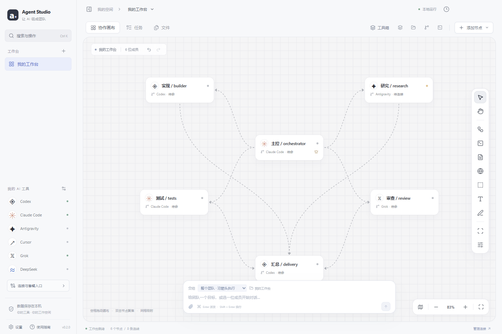

# Agent Studio

Windows 本机多 AI 协作工作台。把已有的 AI 工具放到同一张画布上，分配角色、传递任务、检查结果。

**当前：0.2.0 基线预发布。** 这是后续持续优化的起点，界面与交互仍在迭代，不表示已经达到 MAO 的完整功能或成熟度。

[下载发行包](https://github.com/fanchengliu/Agent-studio/releases) · [功能与快捷键](docs/WINDOWS-0.2.md) · [后续优化](docs/ROADMAP.md) · [验证范围](docs/VERIFICATION.md)



## 直接使用

1. 从 Releases 下载 Windows 完整包并解压。
2. 打开 `Windows/Agent Studio.exe`；普通便携包也可能直接将 EXE 放在根目录。
3. 进入“连接与套餐入口”，指定本机工具并通过原服务商登录。
4. 选择项目目录，创建团队，设置角色和模型，再派发任务。

请保留整个应用目录，不能只复制 EXE。更新时先退出旧版。应用没有付费激活，AI 工具仍使用你自己的订阅或 API 计费。

## 当前功能

- 浅色/深色画布、紧凑节点、平移缩放、多选、连线、分组、绘制、书签、撤销与重做。
- 原生 CLI / ACP / API 适配、独立会话、任务队列、依赖流程、广播、权限询问与结果记录。
- 角色库、团队模板、共享便签、笔记本、附件和跨本机工作台连接。
- 原生终端、文件编辑、Git 差异与提交、独立工作树、浏览器页面操作。
- 日历排期、本地备份、通知和托盘后台运行。

| 工具                                  | 入口                    |
| ------------------------------------- | ----------------------- |
| Codex                                 | 官方 `app-server`       |
| Claude Code                           | 官方 CLI 结构化输入输出 |
| Cursor / Grok / OpenCode / Gemini CLI | ACP 适配                |
| Antigravity / 自定义 CLI              | 结构化命令行输出        |
| DeepSeek / 兼容服务                   | 自备 API Key            |

工具版本、登录方式和模型授权会影响可用性。“检测到工具”不等于“真实任务已验证”。独立账号目录目前专门适配 Codex 和 Claude Code。

## 从源码运行

需要 **Windows x64、Node.js 24+、Git**；各家 AI CLI 单独安装。

```powershell
git clone https://github.com/fanchengliu/Agent-studio.git
cd Agent-studio
npm ci --ignore-scripts
npm run setup:runtime
npm run dev
```

`setup:runtime` 准备并校验 Electron 运行环境，`dev` 构建界面并打开桌面应用。已有构建可用 `npm start` 或 `start.cmd` 启动。

```powershell
npm run verify       # 语法、生产构建与核心测试
npm run test:canvas  # 画布与工具箱检查，需要 Edge
npm run test:ui      # Windows 桌面与终端检查，需要 Edge
npm run package     # 创建包含运行环境的便携目录
npm run test:package # 验证最新便携包
```

更多说明：[架构](docs/ARCHITECTURE.md)、[开发约定](CONTRIBUTING.md)、[打包发布](docs/RELEASING.md)。

## 数据和范围

工作台数据在 Electron 的 `userData/workspace` 中；项目文件在用户选择的目录。源码、发行包和 Git 历史不包含运行数据或账号凭据。模型 Key 使用系统加密，原 CLI 的登录资料仍由原工具管理。

当前目标是 Windows 本机客户端。SSH、手机、Mac 和在线商业服务不在本次范围。原生 CLI 的操作权限由其自身设置与本应用的批准处理共同决定，本应用不是完整的操作系统沙箱。

自动化测试使用隔离目录和协议测试进程，未发送真实模型任务。跨厂商真实账号的完整协作仍待实测，具体设计和技术债务列在 [ROADMAP](docs/ROADMAP.md)。

## 许可证

本项目源码使用 [MIT License](LICENSE)。各依赖和各家 AI 工具保留各自许可证与服务条款。
